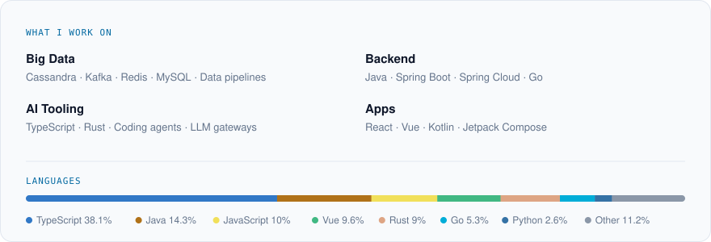

# Owlbay

Infrastructure engineer building full-stack AI applications and developer tools. Previously in big data.

[Website & notes](https://owlbay.dev) · [X](https://x.com/owlbays) · [Email](mailto:me@owlbay.dev)

### What I work on

- **AI developer tools** — coding agents, LLM gateways, and developer workflows.
- **Full-stack applications** — TypeScript, React, Vue, Rust, and Go.
- **Infrastructure & backend** — Java, Spring Boot, databases, and services.
- **Data systems** — Kafka, Cassandra, Redis, MySQL, and data pipelines.

Languages across my contributions

<picture>
  <source media="(prefers-color-scheme: dark)" srcset="./assets/skills-dark.svg">
  
</picture>

Based on lines added in my non-merge commits on default branches, across repositories included in the latest scan.

